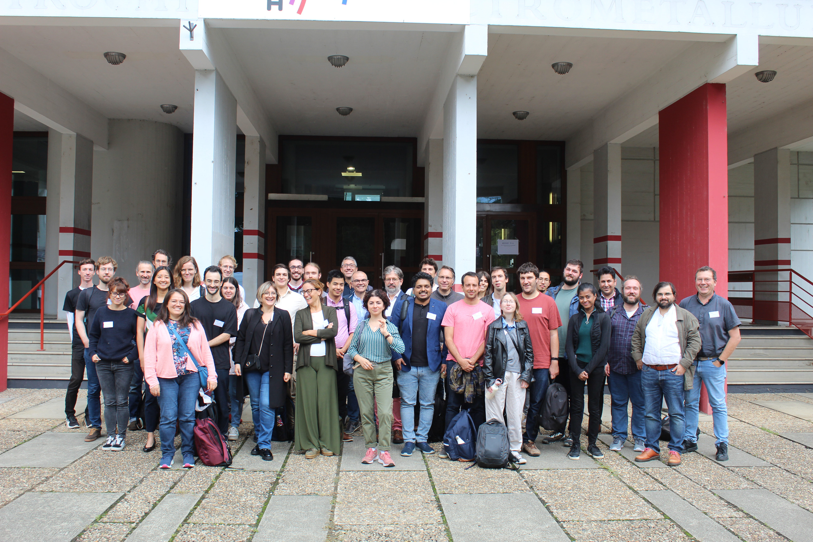

## Machine Learning Interatomic Potentials and Accessible Databases

[CECAM web page for the event](https://www.cecam.org/workshop-details/machine-learning-interatomic-potentials-and-accessible-databases-1313)

### Organisers

- **Magali BENOIT** (CEMES, CNRS, Toulouse)
- **Arthur FRANCE-LANORD** (CNRS)
- **Noel JAKSE** (Université Grenoble Alpes)
- **Antonino MARCO SAITTA** (IMPMC - Université Pierre et Marie Curie (UPMC) - Paris)

Machine Learning Interatomic Potentials (MLIPs) have positioned themselves as a key tool for atomistic modeling in materials science. MLIPs cover an expansive range of systems, taking advantage of the highly accurate electronic structure calculations based on quantum mechanics, but at a significantly lower computational cost. They allow to scale up atomistic simulations to larger systems, longer timescales, and more complex phenomena; they therefore significantly contribute to the acceleration of the discovery of novel structural and functional materials, and in the advancements in our understanding of matter. Ground-breaking bodies of work have been published since the seminal work of Behler and Parrinello in 2007, transforming the field into a rapidly evolving research discipline. However, alongside these advancements, a crucial challenge emerges: the need for standardized protocols for MLIP generation and storage, as well as comprehensive, accessible databases for _ab initio_ datasets.

### Past event: download or view the presentation slides and event photos

#### Slides

- **Jörg BEHLER** [The Cambrian Explosion of Machine Learning Potentials](/downloads/cecam-workshop/slides-behler-2024-09-09-CECAM-workshop.pdf)
- **Martin UHRIN** [Symmetry-aware models beyond energies and forces](/downloads/cecam-workshop/slides-uhrin-2024-09-09-CECAM-workshop.pdf)
- **Johannes SANDBERG** [Feature selection for neural network potentials with the adaptive group lasso](/downloads/cecam-workshop/slides-sandberg-2024-09-10-CECAM-workshop.pdf)
- **François-Xavier COUDERT** [Data-based methods to accelerate discovery of novel materials and find new properties in old ones](/downloads/cecam-workshop/slides-coudert-2024-09-10-CECAM-workshop.pdf)
- **Julia YANG** [Development of MLIP workflow for reactive, organic solvents](/downloads/cecam-workshop/slides-yang-2024-09-10-CECAM-workshop.pdf)
- **Gian-Marco RIGNANESE** [Systematic assessment of various universal machine-learning interatomic potentials](/downloads/cecam-workshop/slides-rignanese-2024-09-11-CECAM-workshop.pdf)
- **Thierry DEUTSCH** [Setting up data tools as part of the DIADEM program](/downloads/cecam-workshop/slides-deutsch-2024-09-11-CECAM-workshop.pdf)
- **Kristjan EIMRE** [Generating and publishing datasets using AiiDA and Materials Cloud](/downloads/cecam-workshop/slides-eimre-2024-09-11-CECAM-workshop.pdf)

[Download photos from the event ](/downloads/cecam-workshop/cecam-workshop-photos.zip)

Taken by Joao Paulo Almeida De Mendonca
